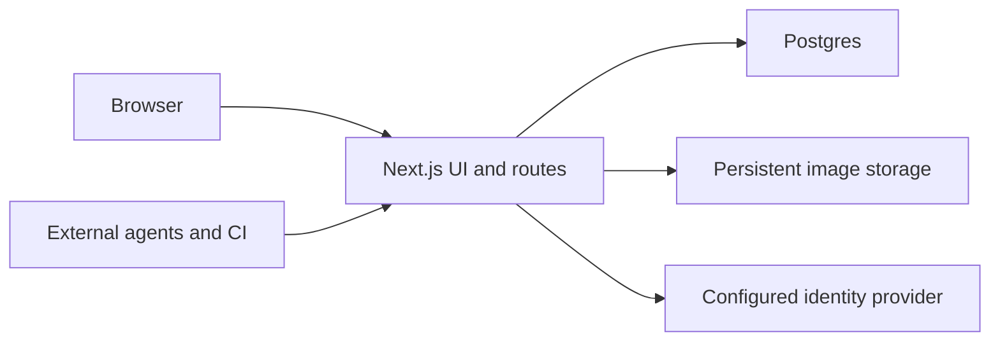

One Next.js process serves the app, REST, MCP, and stored images. Postgres holds structured records and sessions. Files live under a persistent data directory. The configured OIDC provider handles sign-in.[^readme]

The app uses Next.js 16 App Router, React 19, MUI 7, and Emotion. TypeScript is strict with `noUncheckedIndexedAccess`. Domain components live under `src/components/`. Files use kebab-case and named PascalCase exports.[^package]

The runtime build enables Cache Components and partial prefetching. Request-dependent pages need a loading or Suspense shell. Await dynamic route parameters. Caching is explicit through `"use cache"`. Segment-level `dynamic`, `revalidate`, and `fetchCache` settings do not fit this configuration.[^next]

Read the installed Next.js guide under `node_modules/next/dist/docs/` before changing Next-specific behavior. The configuration enables the compiler through `reactCompiler: true`. Apply the repository React skills before adding manual memoization.[^next]

MUI theme tokens define app presentation through the [design system](../design-system/overview.md). Fumadocs uses a scoped Tailwind stylesheet only for `/docs`. Do not add Tailwind or CSS modules to app components.[^layout]

Server modules for database, authentication, and private media retain `server-only`. Reuse HTTP helpers and existing dependencies. Server runtime code must not fetch evidence URLs or contact services beyond the configured identity provider.[^auth]

The GitHub Pages build serves static docs and examples. Its preparation removes runtime routes from the checkout, so [verification](../engineering/verification.md) requires a disposable copy. Production uses the standalone build, Postgres, and persistent media storage.[^pages]

[Persistence](persistence.md) owns transactions and files. [Access](access.md) owns request authentication and disclosure. [Local development](../engineering/local-development.md) describes the running services.

[^package]: Dependency versions and script entry points.

[^next]: Runtime and static-export Next.js configuration.

[^layout]: App layout, theme providers, and docs stylesheet boundary.

[^auth]: OIDC authentication and shared database pool.

[^readme]: Deployment architecture and runtime network boundary.

[^pages]: Destructive static-export preparation.
