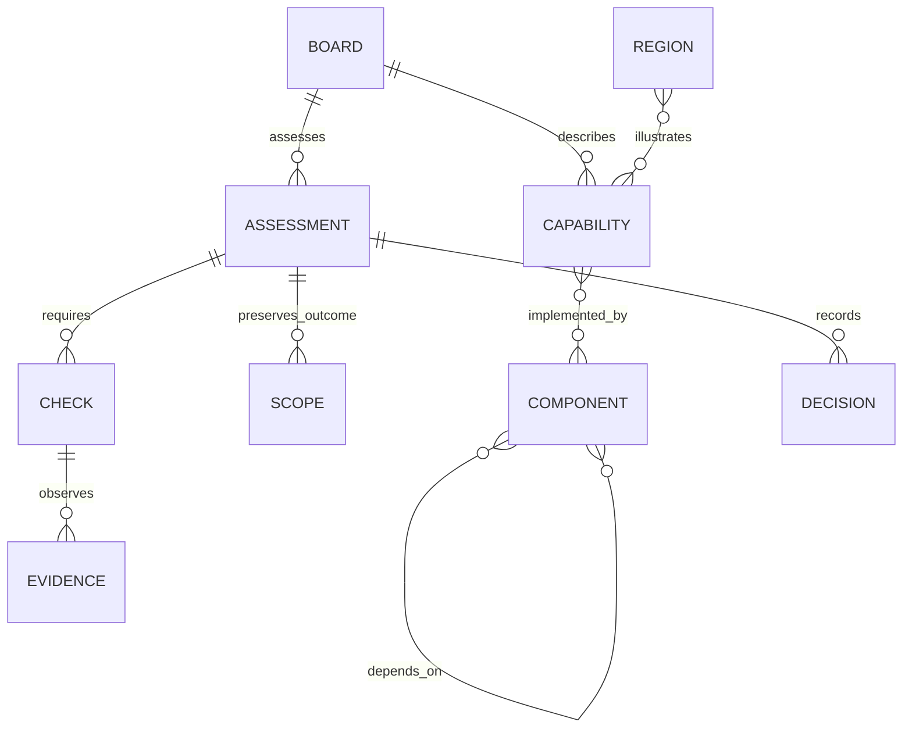

A board is the product boundary. Capabilities belong to a board. Components belong to the workspace and can support capabilities on several boards.[^types]

Capability
: An observable user or business outcome, with an accountable owner and versioned definition.

Component
: An implementation reference of kind `service`, `api`, `event`, `worker`, `datastore`, or `external`.

Dependency
: A declared consumer-to-provider relationship. Its relation and description explain the call, event, job, or data requirement. An edge does not prove runtime behavior.

Assessment
: One immutable candidate reference, validation environment, target environment, audience, and configuration reference. Changing this tuple requires another assessment.

Scope
: Included or excluded capabilities, with preserved outcomes and definition revisions. Exclusion requires a reason and archives that capability's checks.

Check
: A versioned claim targeting a capability, linked component, or entire release. It names the owner, verification method, expected environment, category, and evidence lifetime.

Evidence
: An append-only observation for one exact check revision and assessment context. Results are `pass`, `fail`, or `inconclusive`.

Decision
: A human owner's approval or hold, preserving the reviewed records, rationale, time, and selected media.

The check categories are `functional`, `integration`, `ux`, `data`, `security`, and `operational`. A dependency marked required does not create a required check. [Readiness](readiness.md) uses explicit checks.[^types]

The assessment preserves its original capability outcome. Explicitly adopting a changed outcome revises checks and requires fresh evidence. Re-including an excluded capability requires new checks.[^guide]

Visual regions retain `shipped`, `mock`, and `missing`. `shipped` means working in production for the intended users. Region geometry uses normalized `[0, 1]` coordinates. These states do not calculate release readiness.[^visual]

The product workspace opens its overview at `/boards/:id/releases`. The `section` query selects release history, capabilities, components, or connections and persists through browser navigation. Assessment views remain at `/boards/:id/releases/:releaseId`.[^navigation]

The [product overview](../design-system/patterns/product-overview.md) combines the current catalog with the latest assessment's retained scope. It distinguishes included outcomes, explicit exclusions, and capabilities never added to that assessment. Retained definitions remain visible when the catalog changes. The latest assessment describes one candidate, not the whole product's deployment state.[^overview]

Capability status summarizes that capability's own required checks. Component and release checks still govern the overall assessment. Each check category reports required results separately from optional warnings. A category without checks remains unassessed without adding a new release requirement. Component and screen counts describe declared product mappings and cannot establish readiness.[^overview]

The [persistence boundary](../architecture/persistence.md) preserves definitions and history. The [agent workflow](../architecture/agent-api.md) explains how to reconcile existing records without duplicating them.

[^types]: TypeScript release records and enum definitions.

[^guide]: Release readiness usage guide, scope and definition adoption.

[^visual]: Visual region types and state meanings, also documented in the usage guide.

[^overview]: Product overview rows, candidate coverage, retained definitions, and declared mapping counts.

[^navigation]: Product-section URL state, defaults, and browser-history handling.
